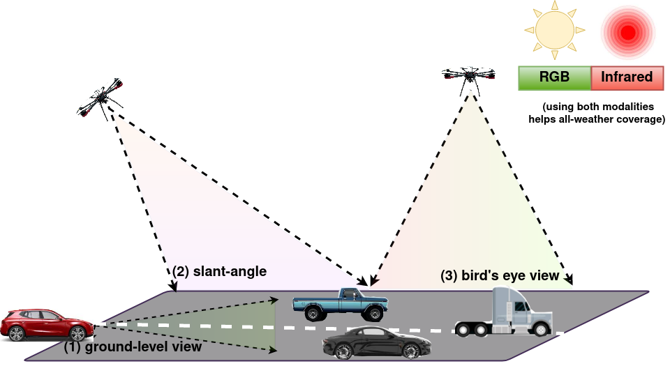

# AetherVision-Bench [CVPRW 2025]

Aniruddh Sikdar<sup>*</sup>, Aditya Gandhamal<sup>*</sup>, Suresh Sundaram

<sup>*</sup>Equal contribution

**Accepted at the Workshop on Foundation Models Meet Embodied Agents (FMEA), CVPR 2025**

[[📄 Paper](https://arxiv.org/abs/2506.03709)] [[🌐 Project Page](https://aniruddhsikdar1.github.io/publications/pixel2perspective/)]



This is the official toolkit for **AetherVision-Bench**, an open-vocabulary RGB-Infrared benchmark for
multi-angle segmentation across aerial and ground perspectives, from the paper "AetherVision-Bench: An
Open-Vocabulary RGB-Infrared Benchmark for Multi-Angle Segmentation across Aerial and Ground Perspectives"
(Workshop on Foundation Models Meet Embodied Agents (FMEA), CVPR 2025).

Open-vocabulary semantic segmentation (OVSS) models are typically evaluated on in-domain, ground-level RGB
datasets. AetherVision-Bench instead evaluates zero-shot transfer across **three viewpoint clusters**
(bird's-eye view, slant-angle, ground-level) and **two sensor modalities** (RGB, infrared), using 6 datasets
selected for their diversity in viewpoint, sensor and class vocabulary:

| Dataset  | Viewpoint    | RGB | IR |
|----------|--------------|:---:|:--:|
| ISPRS Potsdam | Bird's-eye view | ✓ | – |
| UAVid    | Slant-angle  | ✓   | –  |
| IndraEye | Slant-angle  | ✓   | ✓  |
| CART     | Slant-angle  | ✓   | ✓  |
| MSRS     | Ground-level | ✓   | ✓  |
| MVSeg    | Ground-level | ✓   | ✓  |

This toolkit was designed to be easy to use for new model architectures, following the structure of the
[MESS benchmark](https://github.com/blumenstiel/MESS), on which it builds.

## Usage

Follow the steps in [DATASETS.md](DATASETS.md) to download and prepare the datasets, then register them by
adding `import aethervision.datasets` to your evaluation code. If you are using detectron2, the datasets are
registered to the detectron2 `DatasetCatalog`; otherwise `aethervision.utils.catalog.DatasetCatalog` is used.

For evaluating a detectron2-based model on all datasets:
```sh
conda activate <your_env>

TEST_DATASETS="isprs_potsdam_sem_seg_test_rgb uavid_sem_seg_val indraeye_sem_seg_test_rgb indraeye_sem_seg_test_ir cart_sem_seg_test_rgb cart_sem_seg_test_ir msrs_sem_seg_test_rgb msrs_sem_seg_test_ir mvseg_sem_seg_test_rgb mvseg_sem_seg_test_ir"

for DATASET in $TEST_DATASETS
do
 python evaluate.py --eval-only --config-file <your_config>.yaml --num-gpus 1 OUTPUT_DIR output/$DATASET DATASETS.TEST \(\"$DATASET\",\)
done
```

Combine the results of the separate datasets into the paper's tables with:
```sh
python aethervision/evaluation/aethervision_evaluation.py --model_outputs output/<model_name> output/<model2_name> <...>
# default values: --metrics [mIoU], --results_dir results/
```

We also provide `AetherVisionSemSegEvaluator` in `aethervision.evaluation` to compute CoI-mIoU (mIoU over
classes of interest, excluding the background class), requiring `detectron2`.

See [GettingStarted.md](GettingStarted.md) for a full walkthrough and the three evaluation settings used in
the paper (COCO-Stuff-trained, MSRS-trained, IndraEye-trained).

## Summary

To evaluate your model on AetherVision-Bench:

- [ ] Prepare the datasets as described in [DATASETS.md](DATASETS.md)
- [ ] Register the datasets by adding `import aethervision.datasets` to your evaluation code
- [ ] Use the class names from `MetadataCatalog.get(dataset_name).stuff_classes` of each dataset
- [ ] Use `AetherVisionSemSegEvaluator` as your evaluator class (optional, for CoI-mIoU)

## License

This code is released under the [MIT License](LICENSE). The evaluated datasets are released under their
respective licenses, see [DATASETS.md](DATASETS.md) for details. See [datasets.bib](datasets.bib) for the
dataset citations.

## Acknowledgement

This toolkit follows the structure and conventions of [MESS](https://github.com/blumenstiel/MESS)
(Blumenstiel et al., NeurIPS 2023). We thank the dataset providers for making their data publicly available,
and the authors of the evaluated OVSS models for releasing their code and weights.

## Citation

Please cite our paper if you use AetherVision-Bench:

```BibTeX
@inproceedings{sikdar2025aethervision,
  title={AetherVision-Bench: An Open-Vocabulary RGB-Infrared Benchmark for Multi-Angle Segmentation across Aerial and Ground Perspectives},
  author={Sikdar, Aniruddh and Gandhamal, Aditya and Sundaram, Suresh},
  booktitle={Workshop on Foundation Models Meet Embodied Agents at CVPR 2025 (Non-archival Track)},
  year={2025},
  note={Accepted (Non-archival)},
  url={https://arxiv.org/abs/2506.03709}
}
```
